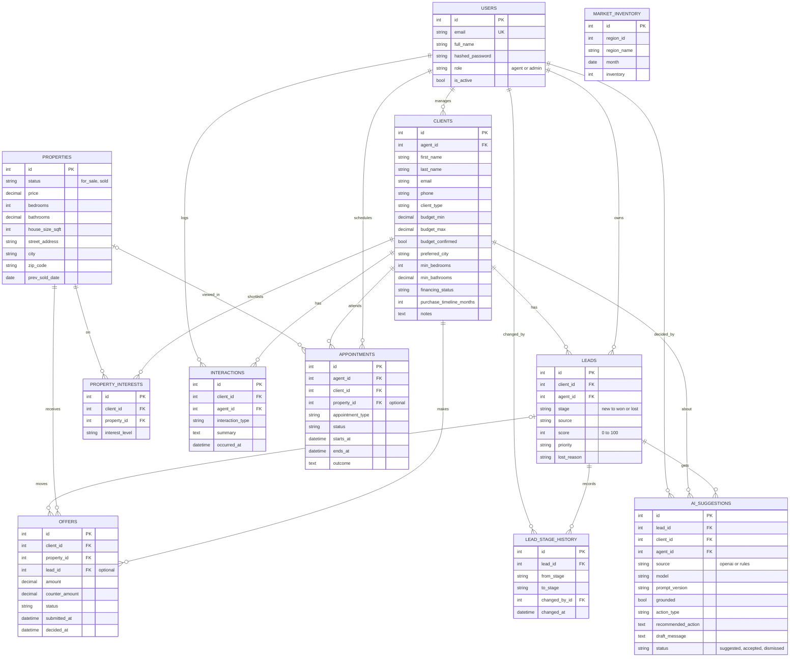

# Database: entity relationship diagram

Eleven tables. GitHub draws the diagram below automatically. Timestamps (`created_at`, `updated_at`) are on every table except `lead_stage_history` and `market_inventory`, and are left out to keep the picture readable.

`market_inventory` stands alone on purpose: the Zillow data has no key that joins to individual listings. Each region has one row per month.
